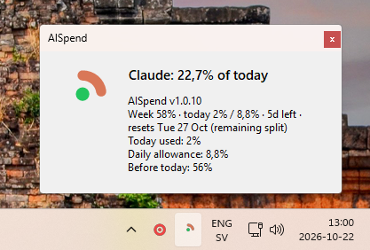
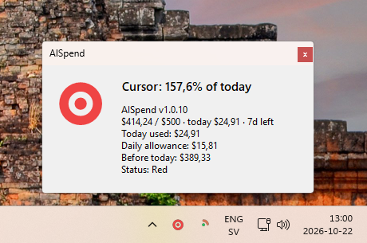

# AISpend

Two quiet rings in your Windows tray — one for **Claude Code**, one for **Cursor** — that show how much of *today’s* allowance you’ve used.

A full ring means you’ve spent today’s share of the remaining budget until reset. Green, yellow, and red are optional status dots in the center.

<p align="center">
  
</p>

<p align="center">
  
  &nbsp;&nbsp;
  
</p>

---

## Install

**Windows 10 (build 19041+) or Windows 11 · 64-bit · no admin**

### PowerShell (recommended)

1. Press **Win**, type **PowerShell**, open **Windows PowerShell**.
2. Paste and press Enter:

```powershell
irm https://github.com/noaignite/aispend-release/releases/latest/download/install.ps1 | iex
```

### Command Prompt or Win+R

If you are in **cmd.exe** (or the Run dialog), `irm` will not work. Use this instead:

```bat
powershell -NoProfile -ExecutionPolicy Bypass -Command "irm https://github.com/noaignite/aispend-release/releases/latest/download/install.ps1 | iex"
```

That’s it. The installer:

- Checks that your PC is supported
- Installs to `%LOCALAPPDATA%\Programs\AISpend` (no UAC prompt)
- Adds a Start Menu shortcut
- Starts AISpend

Uninstall anytime from **Settings → Apps → AISpend**, or run `uninstall.ps1` in the install folder.

> Builds are self-contained. You do **not** need to install .NET separately.

---

## Quick start

1. Sign in to **Claude Desktop** and/or **Cursor** on this PC (AISpend reads their local session — it never asks for your password).
2. Look in the system tray (you may need to open the overflow chevron).
3. You should see two icons: **AISpend Claude** and **AISpend Cursor**.
4. **Left-click** an icon for a short status popup. **Right-click** for the menu.

Pin them if Windows hides them: right-click the taskbar → **Taskbar settings** → **Other system tray icons** → turn on **AISpend Claude** / **AISpend Cursor**.

---

## Reading the rings

| What you see | Meaning |
| --- | --- |
| Empty → full ring | How much of *today’s* allowance you’ve used |
| Full angry red ring | You’ve gone past today’s allowance |
| Optional center dot | Green / yellow / red vs your thresholds |
| Tooltip | Short summary (hover the icon) |

**Claude** tracks weekly utilization from Anthropic and paces what’s left across the counted days until reset (reset time is rounded to the nearest local midnight).

**Cursor** tracks dollar spend toward a max (Cursor’s personal limit or a custom amount) over a period you choose, with the same daily pacing idea.

---

## Daily allowance (how “today” is calculated)

In **Settings**, each provider has a **Daily allowance** mode:

**Split remaining budget across days left** *(recommended)*  
If 40% of the period is left and 3 counted days remain, today gets `40% ÷ 3`. As the week progresses, the allowance rebalances from what’s still left.

**Fixed share**  
Period max ÷ number of selected weekdays. Every counted day gets the same slice, regardless of what you’ve already spent.

**Counted weekdays** decide which days count (e.g. skip Saturday and Sunday).

---

## Tray menu

Right-click either icon:

| Item | What it does |
| --- | --- |
| **Refresh now** | Pull fresh usage immediately |
| **Details…** | Same as left-click — today’s numbers and status |
| **Settings…** | Preferences (General, Claude, Cursor) |
| **Check for updates** | Look for a newer release |
| **Update to vX.Y.Z** | Shown when an update is available (if auto-update is off) |
| **Start with Windows** | Launch AISpend at sign-in |
| **Exit** | Quit the tray app |

---

## Settings

### General

- **Release repository** — where updates come from (default `noaignite/aispend-release`; change only if you know you need to)
- **Automatically install updates** — download, replace, and restart when a new version appears
- **Check now / Update now** — manual update controls
- **Poll interval** — how often usage is refreshed (minutes)
- **Start with Windows** — same as the tray toggle

### Claude

- Enable / disable the Claude icon
- Counted weekdays
- Ring color (default Claude terracotta)
- Status dot on/off
- Yellow / red thresholds (% of today’s allowance)
- Toast notifications when you hit yellow or red
- Daily allowance mode (split remaining vs fixed share)

### Cursor

Everything Claude has, plus:

- **Budget max** — Cursor’s personal dollar limit, or a custom USD amount
- **Budget period** — Cursor billing cycle, custom week, or custom month (with a clear start-day control)

---

## Notifications

Optional Windows toasts fire the first time you cross yellow or red **that day** (red supersedes yellow). Click a toast to open details.

---

## Updates

With **Automatically install updates** on, AISpend checks after startup and every few hours. Updates install into the same per-user folder — still no admin prompt — then the app restarts.

You can always check manually from the tray menu or **Settings → General**.

---

## Requirements & privacy

| | |
| --- | --- |
| OS | Windows 10 2004+ (build 19041) or Windows 11, 64-bit |
| Accounts | Claude Desktop and/or Cursor already signed in locally |
| Network | Anthropic / Cursor APIs for usage; GitHub for updates |
| Tokens | Read from local Claude / Cursor storage only — AISpend never stores or uploads your passwords |
| Data on disk | Settings & state under `%APPDATA%\AISpend` |

---

<p align="center">
  <sub>Made for calm daily pacing — not another dashboard.</sub>
</p>
